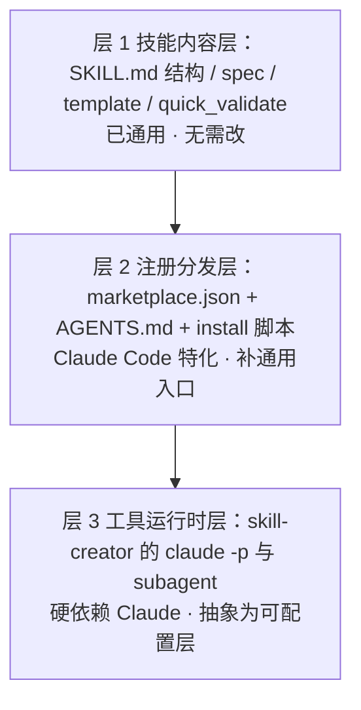
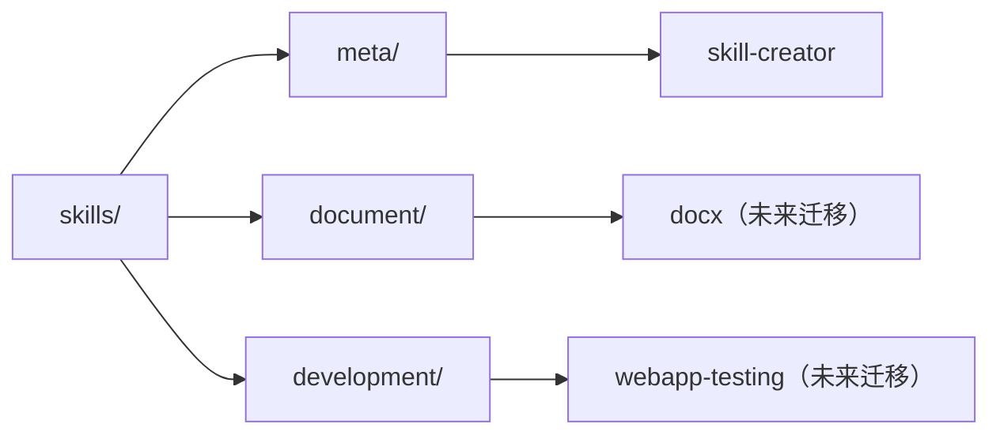
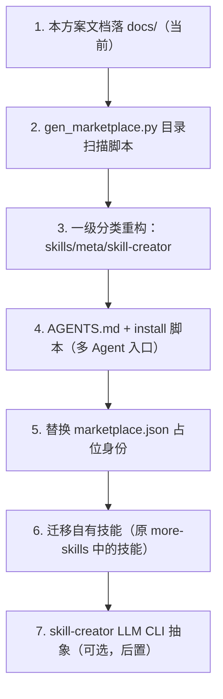

# 技能库重组与通用化改造方案

> 日期：2026-10-15
> 状态：方案已定，待实施
> 关联：anthropics/skills 调研笔记见 Technology-Lectotype 项目目录下 `anthropics-skills-调研笔记.md`

## 一、背景

本仓库于 2026-10-15 基于 [anthropics/skills](https://github.com/anthropics/skills)（Agent Skills 开放标准的官方参考实现）搭建。

- 初始骨架为 anthropics/skills 官方 clone 的最新版（commit `dbd4588`，2026-10 拉取），仅保留框架文件与 `skill-creator` 元技能，不含 source-available 的 `document-skills`（docx/pdf/pptx/xlsx，许可不可再分发）。
- 已在 GitHub 建立公开仓库并推送：**https://github.com/jinnnyang/skills**（初始提交 `941b2b6`）。
- 本仓库定位为个人技能库：骨架照搬官方，后续技能自行填充；更长远的目标是让技能库**不只服务 Claude，而是通用 Agent 可用**。

## 二、当前状态快照

```
skills/
├── .claude-plugin/marketplace.json  # 插件注册表（Claude Code 入口，身份为占位）
├── skills/
│   └── skill-creator/               # 元技能：创建/评估/优化其他技能（完整管线）
├── spec/agent-skills-spec.md        # 规范指针（正文见 agentskills.io）
├── template/SKILL.md                # 最小技能模板
├── README.md
└── .gitignore
```

- 已跟踪文件 23 个；git 工作区干净。
- `skill-creator` 结构完整：`SKILL.md` + `LICENSE.txt`（Apache-2.0）+ `agents/`（grader、analyzer、comparator）+ `scripts/`（9 个）+ `eval-viewer/`（generate_review、viewer.html）+ `references/` + `assets/`。
- 已验证：`quick_validate.py` 对 skill-creator 与 template 均返回 `Skill is valid!`（10 道验证门通过）；9 个 Python 脚本 `py_compile` 全通过；运行依赖 PyYAML 已安装。

**待办占位**：`marketplace.json` 中 `name: personal-skills`、`owner.email: CHANGE-ME@example.com` 为占位，注册 Claude Code 市场前必须替换。

## 三、改造目标

1. **通用化**：从"Claude 定制"变为"通用 Agent 可使用"，同时保留 Claude Code 作为一等入口。
2. **分类存储**：技能数量增长后，按领域对 `skills/` 分类，避免扁平目录失控。

## 四、通用化改造：三层清单

技能内容层已基于开放标准（天然通用），改造集中在注册分发层与工具运行时层。

| 层 | 组件 | 现状 | 改造动作 |
|---|---|---|---|
| 技能内容层 | `skills/<name>/` 目录结构、`spec/`、`template/` | Agent Skills 开放标准（agentskills.io），跨 Agent 采用 | 无需改 |
| 技能内容层 | `quick_validate.py` | 纯 Python + yaml，无 Claude 依赖 | 无需改 |
| 技能内容层 | `aggregate_benchmark.py`、`eval-viewer/` | 纯 Python | 无需改 |
| 注册分发层 | `.claude-plugin/marketplace.json` | Claude Code 插件市场格式 | 保留为 Claude 入口 |
| 注册分发层 | 顶层 `AGENTS.md` | 不存在 | **新增**：声明技能目录，供多数 Agent 读取 |
| 注册分发层 | 安装脚本 | 不存在 | **新增**：把 `skills/` 下技能 symlink 到各 Agent 技能目录（`~/.claude/skills`、`~/.codex/skills`、`.agents/skills` 等） |
| 注册分发层 | README | 安装说明为 Claude Code 命令 | 改写为多 Agent 安装说明 |
| 工具运行时层 | `improve_description.py` | 硬编码调用 `claude -p` 子进程 | 抽象为可配置 LLM CLI（环境变量指定命令） |
| 工具运行时层 | `run_loop.py` / `run_eval.py` | 依赖 Claude Code subagent 语义（with_skill / 基线对照） | 抽象为宿主编排层 |
| 工具运行时层 | `agents/*.md` | prompt 文本本身通用 | 执行依赖宿主 subagent，需宿主支持 |



**优先级建议**：

- 低成本先行：`AGENTS.md` + 安装脚本即可覆盖大部分多 Agent 接入需求，技能目录对任何读 `AGENTS.md` 的 Agent 可见。
- `skill-creator` 的 LLM CLI 抽象工程量较大，若以 Claude 为主、其他 Agent 偶尔接入，可后置或保持 Claude-only。

## 五、分类目录改造

将扁平的 `skills/<name>/` 改为按领域分类。**第一步只做一级分类**（`skills/<category>/<name>/`），跑一段时间后再决定是否拆 sub-category。

### 5.1 兼容性依据（已核实）

- `marketplace.json` 的 `skills[]` 是相对路径字符串，支持任意深度（`./skills/meta/skill-creator` 合法）。
- `quick_validate.py` 的 `validate_skill(path)` 接受任意路径，只校验目录内是否有 SKILL.md。
- frontmatter 的 `name` 是唯一标识（kebab-case），与目录位置解耦，触发匹配不受目录层级影响。
- 生态先例：mattpocock/skills 采用 `<bucket>/<skill>/` 分层结构（engineering/、productivity/ 等），并在插件清单中引用分桶路径。

### 5.2 分类规则

- 按**稳定领域**分类（示例：document / development / communication / meta），**不按状态**分类（in-progress / deprecated 等会频繁搬动）。
- 二级目录（sub-category）非必须；单技能分类只挂一级。
- 目录分类是"组织维度"，marketplace plugin 分组是"分发维度"——以目录分类为主，plugin 分组保持精简（暂时只保留 `core`），避免同一份技能在两边重复登记。

### 5.3 配套：自动生成 marketplace.json 的脚本

分类后手工维护注册表易错且重复。新增一个纯 Python 脚本（如 `scripts/gen_marketplace.py`）：扫描 `skills/` 下所有含 `SKILL.md` 的目录，自动生成 `.claude-plugin/marketplace.json` 的 `skills[]` 路径清单。之后加技能、调分类、改名均零成本，注册表不遗漏。

### 5.4 已知副作用

`skill-creator` 把评估工作区放在技能目录的 sibling（`<skill-name>-workspace/`）。技能在深层路径时，工作区会嵌进分类树（如 `skills/document/word/docx-workspace/`）。可接受，需知悉。

### 5.5 结构示意



## 六、实施顺序



1. 本方案文档落 `docs/`（当前步骤）；
2. 编写 `gen_marketplace.py` 目录扫描脚本；
3. 一级分类重构：`skills/skill-creator` → `skills/meta/skill-creator`，重新生成 marketplace 并跑验证；
4. 新增顶层 `AGENTS.md` + install 脚本（多 Agent 入口）；
5. 替换 marketplace.json 占位身份；
6. 迁移自有技能（从旧 more-skills 中挑选，逐个搬入并验证）；
7. `skill-creator` 的 LLM CLI 抽象（可选，后置）。

## 七、许可与来源

- 骨架与 `skill-creator` 源自 [anthropics/skills](https://github.com/anthropics/skills)（Apache-2.0），各技能目录内保留 `LICENSE.txt`。
- 未包含 `document-skills`（docx/pdf/pptx/xlsx）：source-available，不可再分发，仅可参考其设计思路自行实现。
